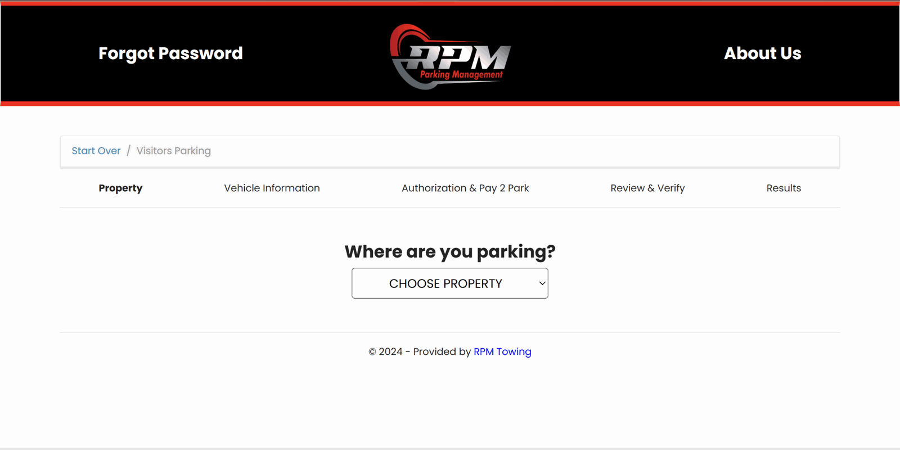
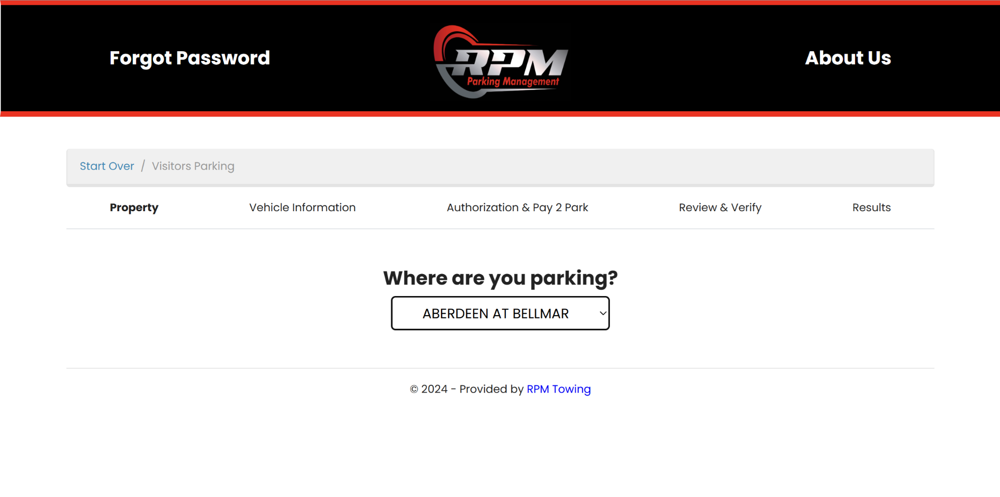
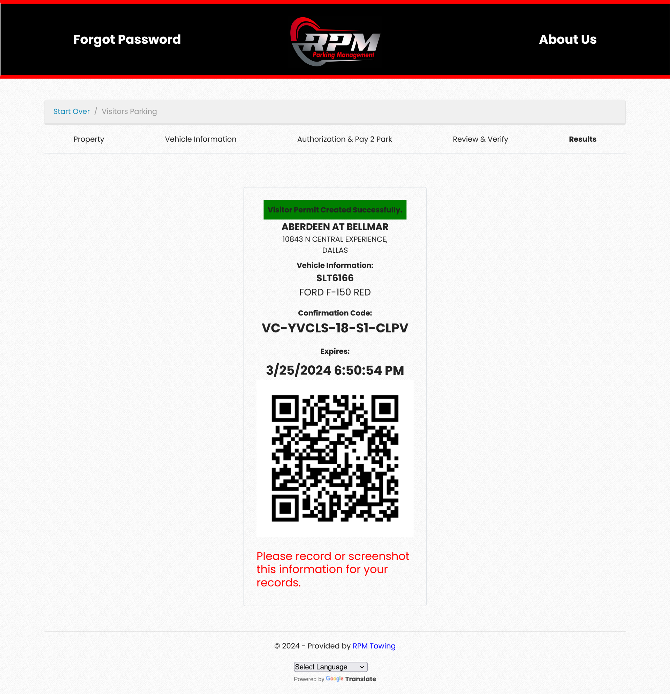
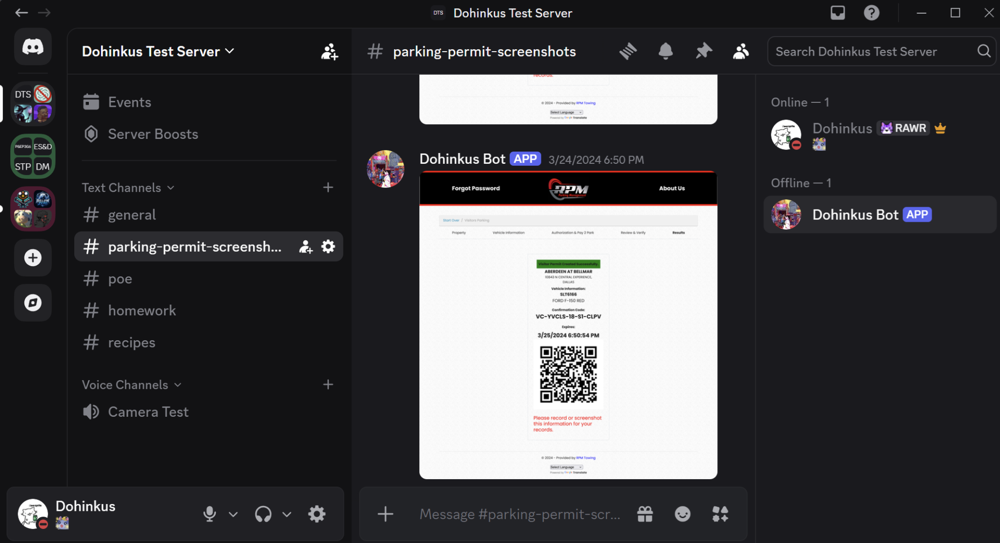
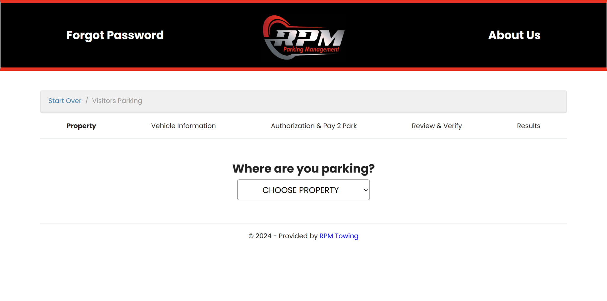
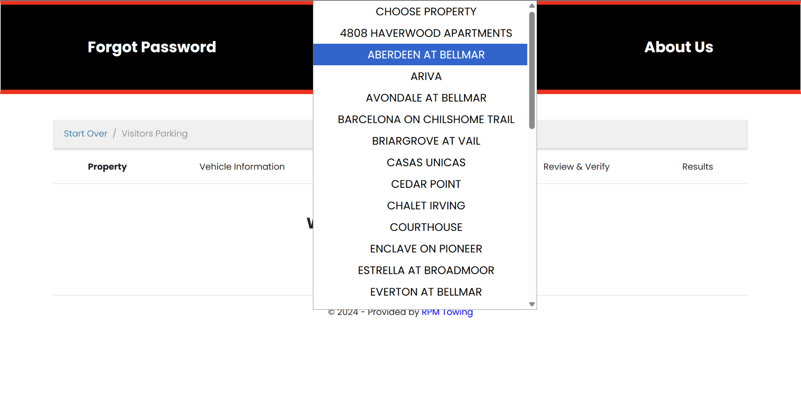

# Demo! (GIF may take a few seconds to load)

# Parking Permit Generator

**A Python automation project that filled out a visitor-parking website, generated a parking permit, and sent proof of the permit to Discord.** It also supported optional automatic renewal, so I wouldn't have to keep repeating the same process manually.

> [!IMPORTANT]
> **Project status: archived! - no longer functional as written.** This project was built for the old RPM2Park visitor-parking website back when I lived in Dallas in 2024. The website's URL and workflow have since changed, so the original automation no longer works. I've moved away and don't plan to update it. The code and screenshots are preserved here to demonstrate what I built! :)

## Why I built it

I was inspired by a **$200 tow fee** after a three-hour gap between my free visitor parking permits. So the obvious next step was to build this tool to automate the permit-registration process, keep a screenshot of the result, and schedule my next permit when the current one expired!! STOP TOWING ME!! >:(

## How it worked

1. **Select the parking location.** Python used Selenium and Firefox to open the visitor-parking website, choose the apartment property from a dropdown, and then entered the apartment number.
2. **Fill out the vehicle and confirmation forms.** The script entered the license plate, vehicle make, model, and color; advanced through the authorization page; re-entered the plate for verification; checked the confirmation box; and submitted the form.
3. **Capture the completed permit.** Once the confirmation page loaded, it read the expiration date, waited for the QR code, and captured a full-page screenshot.
4. **Send the permit to Discord (optional).** A Discord bot uploaded the screenshot to a configured channel.
5. **Schedule renewal (optional).** The program could also create a Windows Task Scheduler task to run itself again **at the permit's expiration time**, since you weren't allowed to renew your permit until it expired which is why I originally got towed >:(

The optional features and vehicle/property details were controlled through `config.yaml` rather than hard-coded into the Python script!! Because configs are very nice :3

## The workflow, in pictures

These are **original screenshots from 2024**, not recreations. I no longer have screenshots of the intermediate vehicle-information and authorization pages; the Python source documents how those steps were automated.

### 1. Select the property on the parking website

The visitor-parking portal after a property was selected. The script handled this dropdown along with the remaining form fields.

  

<strong>↓ Selenium enters apartment and vehicle details, completes confirmation, and submits the form ↓</strong>

### 2. Generate the parking permit

The result was a permit confirmation showing the property, vehicle information, expiration time, confirmation code, and QR code.

  

<strong>↓ The Discord bot uploads a screenshot of the permit ↓</strong>

### 3. Deliver it to Discord

When enabled, the bot posted the screenshot to a Discord channel so I could access the permit confirmation later.

  

<strong>See two more screenshots of the original property-selection process</strong>

**Initial visitor-parking screen**

**Property dropdown expanded**

## Technologies and features

| Technology | What it did |
| --- | --- |
| **Python** | Coordinated the entire workflow. |
| **Selenium + Firefox** | Interacted with dropdowns, text fields, buttons, and checkboxes in the browser; waited for the right page elements before continuing. |
| **discord.py + asyncio** | Connected a Discord bot and uploaded the generated permit screenshot. |
| **PyYAML** | Read property, vehicle, Discord, and feature settings from `config.yaml`. |
| **Windows Task Scheduler** | Optionally scheduled the next run based on the permit's expiration timestamp. |

## Source files

- [`automatic_parking_permit.py`](automatic_parking_permit.py) - main automation, screenshot capture, Discord delivery, and renewal scheduling.
- [`config.yaml`](config.yaml) - example configuration with switches for screenshots, Discord uploads, and renewals (contains placeholder values).
- [`delete_scheduled_permit_renewal.py`](delete_scheduled_permit_renewal.py) - removes the Windows renewal task.
- [`assets/`](assets/) - the original GIF and five unchanged screenshots, renamed for clarity.

**Historical setup note:** The original implementation relied on the old site's URL and HTML element IDs, a Firefox browser environment, and (for scheduled-task management) administrator permissions on Windows. It is shared as a past project, **not a currently working parking-permit service**!
